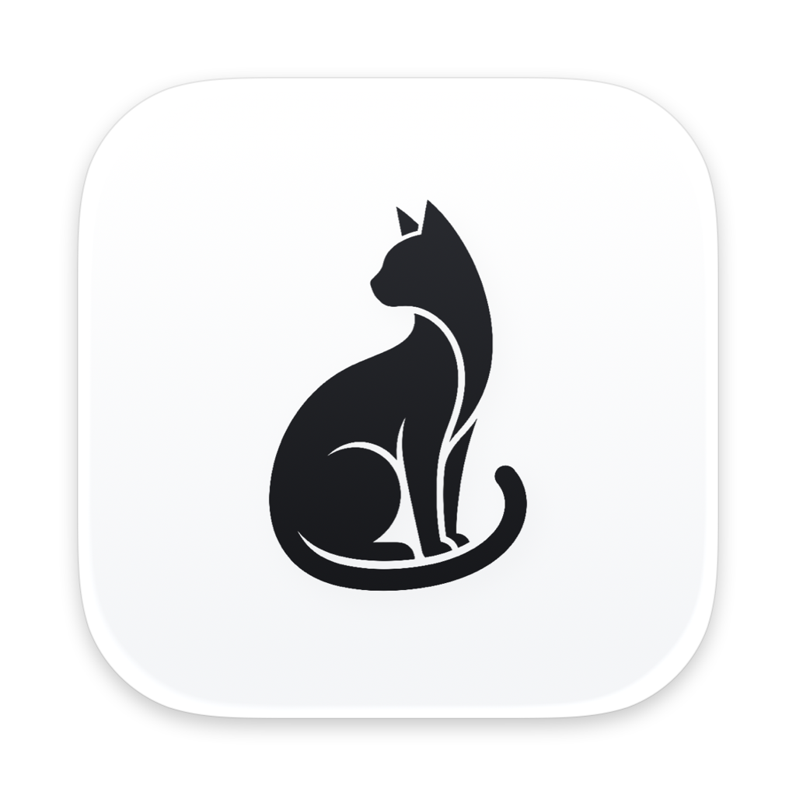

# Glint · Native macOS Productivity Workstation

  

  <b>A unified, ultra-fast macOS workstation blending hardware notch integration, screenshot &amp; recording studio, AI voice dictation, clipboard history, and instant notes.</b> 
  Built natively with Swift and Metal for macOS 14.0+ (Apple Silicon).

  <a href="#-download">Download DMG</a> •
  <a href="#-installation--first-run">Quick Start</a> •
  <a href="#-key-features">Features</a> •
  <a href="#-keyboard-shortcuts">Shortcuts</a> •
  <a href="#-privacy--security">Privacy</a>

---

## 📥 Download

Pre-built DMG installer (`v0.1.58`, `15.3 MB`) for macOS 14.0 (Sonoma) and newer on Apple Silicon (`arm64`):

| Platform | Version | Architecture | System | Package |
|---|---|---|---|---|
| **macOS** | `v0.1.58` | Apple Silicon (`arm64`) | macOS 14.0+ | [**Download Glint.dmg**](./Glint.dmg) |

---

## 🚀 Installation & First Run

1. Download [**`Glint.dmg`**](./Glint.dmg) and drag **Glint** into your **`Applications`** folder.
2. **First-launch Gatekeeper approval** (for ad-hoc preview builds prior to Developer ID notarization):
   - Open **Glint** once from `Applications` (if blocked, click **Done**).
   - Open **System Settings → Privacy & Security**, scroll down to the **Security** section, and click **Open Anyway** next to Glint.
3. **Grant Essential Permissions** when prompted:
   - **Screen Recording**: For screenshot capture, scrolling capture, area OCR, and screen recording.
   - **Accessibility**: For global hotkeys, scrolling capture automation, and voice dictation text insertion.
   - **Microphone & Speech Recognition**: For voice dictation and microphone recording.

---

## ✨ Key Features

### 🫧 Notch Capsule & Top Hub
- Seamlessly anchors to MacBook hardware notches and top screen edges with Metal liquid glass shaders and spring physics.
- **Official Media Controller**: Real-time album artwork, playback controls, and queue/state integration via official channels for **Apple Music** and **Spotify**.
- **Integrated Tool Dock**: Quick access to Flip Clock, Clean Desktop toggle, Native Color Picker, File Shelf, Calendar, Weather, Caffeine sleep prevention, Health Reminder, and Instant Notes.

### 📸 Smart Capture & Professional Annotation
- **Sub-Pixel Snapping & Magnifier**: Instant window and element snapping with GPU-accelerated RGB / HEX color picker.
- **Annotation Tools**: Rectangles, callout arrows, highlighter, step counters, pixelate mosaic, gaussian blur, spotlight, and text.
- **Scrolling Screenshot (Long Capture)**: Sub-pixel image stitching for long webpages, code files, and chats.
- **Smart Privacy Redaction**: Vision-powered automatic detection and blurring of phone numbers, emails, cards, and API keys.
- **Pin to Screen**: Float screenshots on top across spaces with opacity and scale adjustment.

### 🎥 High-Performance Screen Recording & Studio Editor
- Smooth 60 FPS recording with system audio + microphone capture, live canvas brush annotations, smooth cursor zoom, and MP4/GIF export.

### 🎙️ AI Voice Dictation
- Multi-engine support: Offline Apple Speech and user-configured cloud Whisper / OpenAI-compatible endpoints, with cursor text insertion and custom vocabulary rules.

### 📋 Clipboard History & Instant Notes
- Multi-category indexing for text, images, code snippets, colors, and links, paired with a lightweight local Markdown notepad.

### 🌐 In-Place Screen Translation
- Area selection OCR with direct overlay translation rendering supporting offline Apple Translation (macOS 15+) and BYOK DeepL, Google Cloud Translation, Baidu, Youdao, and OpenAI-compatible APIs.

---

## ⌨️ Default Keyboard Shortcuts

| Action | Default Shortcut | Description |
|---|---|---|
| **Area Capture** | `⌘ ⇧ S` | Interactive capture and annotation overlay |
| **Fullscreen Capture** | `⌘ ⇧ 1` | Instantly captures entire screen |
| **Window Capture** | `⌘ ⇧ 9` | Captures the hovered active window |
| **OCR Capture** | `⌘ ⇧ 2` | Extracts text from selected region |
| **Subject Cutout** | `⌘ ⇧ 8` | Extracts foreground subject as transparent PNG |
| **Screen Recording** | `⌘ ⇧ R` | Starts area, window, or full-screen recording |
| **Screen OCR Translate** | `⌘ ⇧ T` | Select area for in-place text translation |
| **Voice Dictation** | `⌘ ⇧ D` | Hold or tap to trigger voice dictation |
| **Command Launcher** | `⌥ Space` | Quick search, app launcher, and inline tools |
| **Toggle Main Window** | `⌘ ⇧ A` | Show or hide the Glint workstation window |
| **Shortcut Cheat Sheet** | `⌘ ⇧ K` | Display all keyboard shortcuts |

*All keyboard shortcuts are customizable in Settings → Shortcuts.*

---

## 🔒 Privacy & Security

- **Offline-First & Zero Telemetry**: Glint collects no analytics, telemetry, or crash reports. Screenshots, recordings, OCR text, clipboard history, and notes remain local on your Mac by default.
- **BYOK Encrypted Credentials**: Any API keys you enter for translation or cloud speech are stored in the macOS Login Keychain and sent only to the provider you select.
- **Optional Network Services**: Weather forecasts use Open-Meteo, and missing media artwork is looked up via Apple's public iTunes Search API.
- Full details: [PRIVACY.md](./PRIVACY.md) • Third-party acknowledgements: [THIRD_PARTY_NOTICES.md](./THIRD_PARTY_NOTICES.md).

---

## 📄 Copyright & Distribution

Copyright © 2026 sqoder. All rights reserved.
Pre-built binary distribution repository. See [THIRD_PARTY_NOTICES.md](./THIRD_PARTY_NOTICES.md) for open-source attributions.
